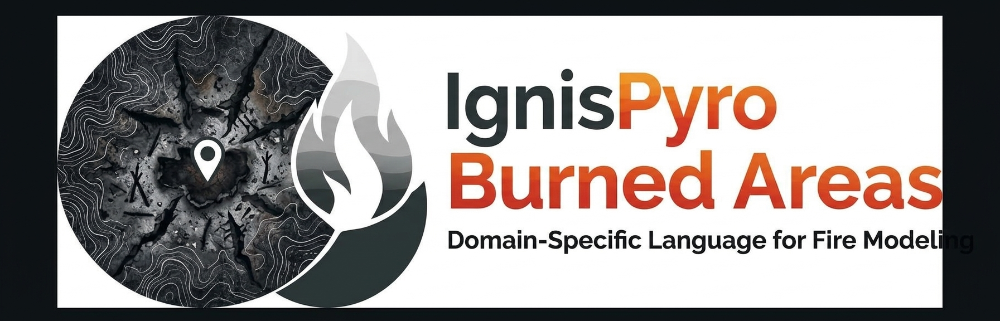

# IgnisPyro Burned Areas

Deteção e acompanhamento de candidatos a áreas ardidas.

- [Documentação do processo](PROCESS_DOCUMENTATION.md)
- [Processamento sazonal](seasonal/README.md)

A imagem identifica o projeto; consulte a documentação para o estado das funcionalidades e as limitações dos resultados.
